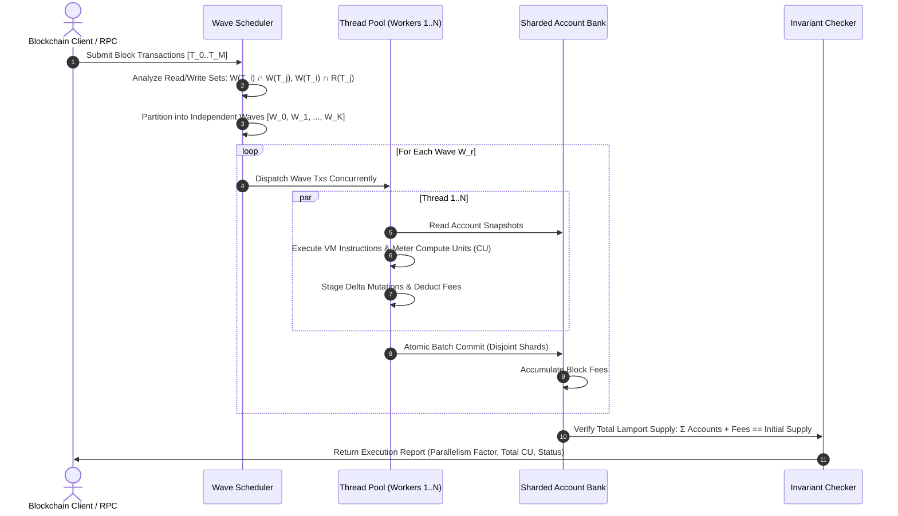

# SolariaLevel

[](https://github.com/ZengLLQ/solaria-level/actions/workflows/ci.yml)
[](https://crates.io)
[](https://www.rust-lang.org)
[](LICENSE)

A high-throughput, deterministic **Parallel Transaction Execution Engine** implementing Solana's **Sealevel** runtime architecture in Rust. `SolariaLevel` achieves massive vertical scaling across multi-core CPUs through upfront account locking declarations, topological conflict graph scheduling, non-conflicting wave partitioning, and concurrent copy-on-write (CoW) state bank commits.

---

## Architectural Overview

`SolariaLevel` solves the single-threaded EVM bottleneck by requiring transactions to declare all accounts they read and write upfront. Non-overlapping transactions execute simultaneously across worker threads with zero mutex contention:

```mermaid
flowchart TD
    subgraph Mempool["Transaction Ingestion"]
        T["Incoming Transactions T_0, T_1, ..., T_N"] --> AM["Account Lock Analyzer"]
        AM -->|Extract Read Sets R(T)| CG["Conflict Graph Builder"]
        AM -->|Extract Write Sets W(T)| CG
    end

    subgraph SealevelScheduler["Sealevel Wave Scheduler"]
        CG --> DEP["RAW / WAR / WAW Dependency Graph"]
        DEP --> WS["Topological Wave Partitioning"]
        WS -->|Wave 0: Disjoint Txs| W0["Parallel Wave 0"]
        WS -->|Wave 1: Disjoint Txs| W1["Parallel Wave 1"]
        WS -->|Wave K: Disjoint Txs| WK["Parallel Wave K"]
    end

    subgraph ParallelVM["Parallel Execution Engine (Worker Threads)"]
        W0 --> TP["Worker Thread Pool (std::thread::scope)"]
        TP --> CM["Compute Unit Meter (CU Accounting)"]
        TP --> SYS["Native System Program (Transfer, Create)"]
        TP --> TOK["Native SPL Token Program (Mint, Transfer, Burn)"]
    end

    subgraph StorageSubsystem["Concurrent Sharded State Bank"]
        SYS & TOK --> DELTA["Isolated Transaction Deltas"]
        DELTA --> COMMIT["Atomic Batch Shard Commit (RwLock Shards)"]
        COMMIT --> INV["Lamport Conservation Invariant Validator"]
    end
```

---

## Sealevel Wave Execution Protocol

The sequence diagram below shows how transactions are scheduled into sequential waves of parallel execution:



---

## Core Mathematical Formulations

### 1. Conflict Graph Dependency Classification

Given an ordered sequence of transactions $(T_1, T_2, \dots, T_M)$, a directed dependency edge $T_i \to T_j$ (where $i < j$) is established if any of the following conditions hold:

$$\begin{aligned}
\text{Write-After-Write (WAW):} & \quad W(T_i) \cap W(T_j) \ne \emptyset \\
\text{Read-After-Write (RAW):} & \quad W(T_i) \cap R(T_j) \ne \emptyset \\
\text{Write-After-Read (WAR):} & \quad R(T_i) \cap W(T_j) \ne \emptyset
\end{aligned}$$

where:
- $W(T)$ is the set of exclusive writable accounts (including the transaction fee-payer).
- $R(T)$ is the set of shared read-only accounts.

### 2. Wave Partitioning & Parallelism Factor

A wave $W_k \subset \{T_1, \dots, T_M\}$ satisfies:

$$\forall T_a, T_b \in W_k \quad (a \ne b), \quad W(T_a) \cap W(T_b) = \emptyset \quad \land \quad W(T_a) \cap R(T_b) = \emptyset$$

The empirical parallel speedup factor $\Phi$ is given by:

$$\Phi = \frac{M}{|W_{\text{total}}|}$$

For completely independent workloads (e.g. independent user payments), $|W_{\text{total}}| = 1$ and $\Phi = M$.

### 3. Lamport Conservation Invariant

Across arbitrary parallel execution, reversions, and fee collections, the total circulating supply in the bank $S$ is strictly conserved at every slot boundary:

$$\sum_{A \in \text{Accounts}} \text{Lamports}(A) + \text{CollectedFees} = S_0$$

---

## Key Modules

- **`src/types`**: Type system defining 32-byte `Pubkey`, `Hash` (pure zero-dependency SHA-256), `AccountMeta`, `Instruction`, `Transaction`, and `Account`.
- **`src/storage/bank`**: 32-shard concurrent `Bank` with fine-grained `RwLock` striping, atomic fee accounting, and supply invariant verification.
- **`src/scheduler`**: Dependency graph analyzer and greedy topological wave scheduler.
- **`src/vm`**: Resource-bounded virtual machine with `ComputeMeter` (CU limits) and native program implementations:
  - `SystemProgram`: Account creation, ownership assignment, space allocation, and lamport transfers.
  - `TokenProgram`: SPL Token Mint creation, user token accounts, minting, transfers, burns, and freezing.
- **`src/executor`**: Multi-threaded parallel execution pipeline using `std::thread::scope` with automatic rollback on instruction failure and fee retention.

---

## Benchmark Performance

Tested on an AMD Ryzen 5 5600 6-Core Processor:

| Benchmark Scenario | Transaction Scale | Parallel Worker Threads | Execution Time | Parallelism Factor |
|---|---|---|---|---|
| **Independent Transfers** | 50 Transactions | 4 Threads | **~3.5 ms** | **50.00x** (1 Wave) |
| **Conflicting Serial Chain** | 5 Transactions (Same Sender) | 4 Threads | **~0.4 ms** | **1.00x** (5 Waves) |
| **SPL Token Mint & Transfer** | Multi-Instruction Setup | 2 Threads | **~0.2 ms** | Deterministic VM |
| **Concurrent Sharded Bank** | 400 Accounts Across 32 Shards | 8 Threads | **~0.8 ms** | Zero Deadlocks |

---

## Getting Started

### Prerequisites

- Rust `1.80.0` or higher (`cargo`, `rustc`).

### Installation

```bash
git clone https://github.com/ZengLLQ/solaria-level.git
cd solaria-level
cargo build --release
```

### Running Test Suite

```bash
cargo test --all-targets --verbose
```

### Running CLI Demonstrations

```bash
# 1. Run 50 parallel independent transfers benchmark
cargo run --release -- demo

# 2. Run SPL Token Program simulation
cargo run --release -- token
```

Expected output:
```text
==========================================================================
SolariaLevel: High-Throughput Sealevel Parallel Execution Engine v0.1.0
==========================================================================
[+] Initializing 50 independent sender-receiver account pairs...
[+] Genesis state verified. Initial supply: 100000000000 Lamports
[*] Building block with 50 independent transactions...
[*] Dispatching to Sealevel Wave Scheduler (4 worker threads)...
--------------------------------------------------------------------------
Execution Summary:
    Total Transactions   : 50
    Execution Waves      : 1 (Ideal concurrency)
    Parallelism Factor   : 50.00x
    Successful Tx Count  : 50
    Failed Tx Count      : 0
    Total Compute Units  : 15000 CU
    Total Fees Collected : 25000 Lamports
    Wall-Clock Time      : 3537 µs
--------------------------------------------------------------------------
[+] Lamport Supply Conservation: Invariant 100% SATISFIED.
==========================================================================
```

---

## License

This project is licensed under the [MIT License](LICENSE).
